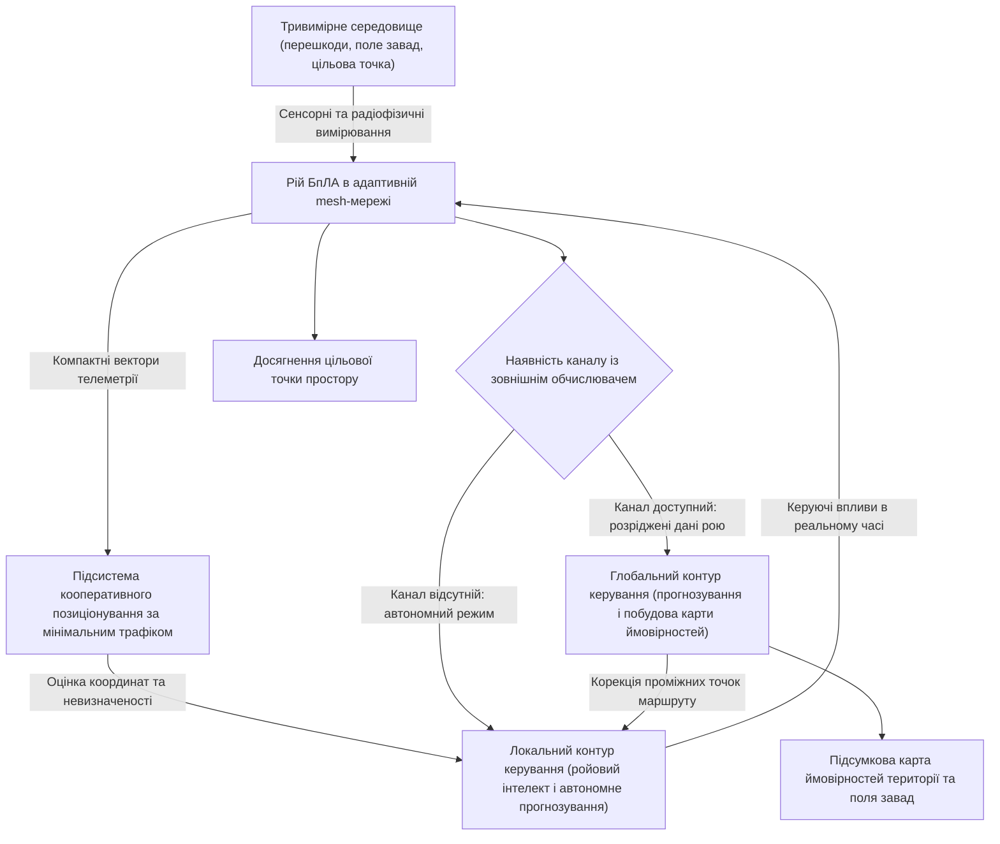
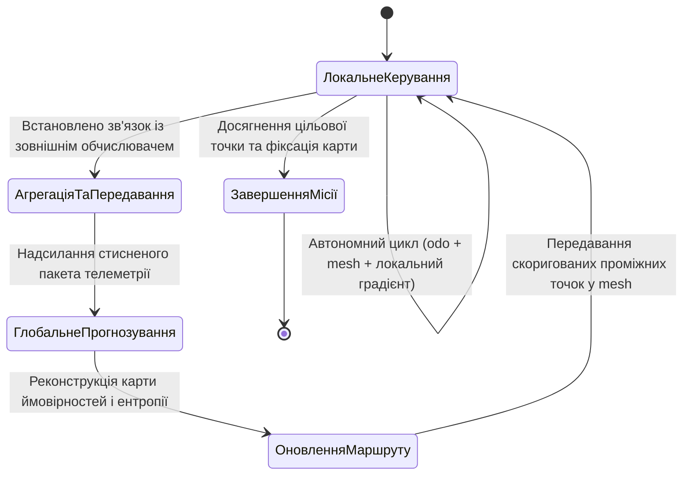
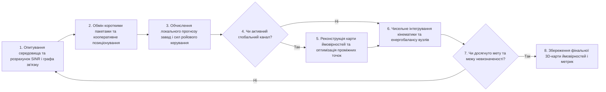

# Концепція адаптивної mesh-мережі для кооперативного позиціонування та інтелектуального картографування завад і території роєм БпЛА

## 1. Загальний опис концепції

### 1.1. Призначення та сфера застосування технології

Сучасні безпілотні авіаційні системи дедалі частіше залучаються до виконання завдань в умовах деградованого інформаційного середовища, де відсутні стабільні сигнали глобальних супутникових навігаційних систем, порушено наземну телекомунікаційну інфраструктуру та присутні інтенсивні електромагнітні перешкоди. Розроблювана концепція спрямована на створення математичних, алгоритмічних і системних засад функціонування децентралізованого рою безпілотних літальних апаратів, здатного діяти автономно або напівавтономно в подібних умовах без жорсткої прив’язки до централізованого диспетчерського керування.

Технологія має виражене подвійне призначення з чітко визначеною пріоритетністю застосування. Першочерговим напрямом її використання є пошуково-рятувальні операції у складних природно-техногенних умовах, оперативне реагування на надзвичайні ситуації та ліквідація наслідків стихійних лих. Під час землетрусів, повеней, лісових пожеж чи масштабних промислових аварій стандартні канали зв’язку зазвичай виявляються зруйнованими або перевантаженими, а геометрія середовища суттєво змінюється через завали, задимлення та радіофізичні аномалії. У таких ситуаціях рій безпілотних вузлів повинен самостійно прокласти шлях до постраждалих або осередку лиха, зберегти внутрішню зв’язність мережі та сформувати актуальну карту прохідності простору й аномальних електромагнітних зон. Вторинною сферою застосування концепції є оборонний сектор, де аналогічні алгоритми можуть бути використані для ведення повітряної розвідки, моніторингу радіоелектронної обстановки та обходу зон активної радіоелектронної протидії.

### 1.2. Сутність ідеї та кінцева задача рою

На поточному етапі дослідження розглядається виключно ідеалізована теоретико-математична концепція, вільна від обмежень конкретних серійних апаратних платформ. Центральна ідея полягає у поєднанні самоорганізованої децентралізованої mesh-мережі та інтелекту рою для одночасного розв’язання навігаційної й картографічної задач за суворого обмеження пропускної здатності каналу передавання даних. Замість трансляції надлишкових сирих сенсорних потоків кожен вузол обмінюється із сусідами виключно компактними інформаційними векторами, що містять оцінку власного просторового положення, показники невизначеності навігації та локальні вимірювання радіоелектронного фону.

Кінцевою метою функціонування рою є гарантоване виведення групи агентів (або визначеного цільового вузла) до заданої кінцевої точки тривимірного простору з одночасною побудовою комплексної ймовірнісної карти території та поля завад. Зазначена карта не зводиться до бінарного поділу простору на вільні та зайняті ділянки, а містить просторовий розподіл імовірності наявності фізичних перешкод, імовірності перевищення критичного рівня радіоелектронних завад і кількісну оцінку інформаційної невизначеності для кожної ділянки середовища.

### 1.3. Концептуальна архітектура дворівневої взаємодії

Для досягнення балансу між високою оперативною автономністю та обчислювальною точністю глобального прогнозування система керування роєм проєктується за дворівневою ієрархічною схемою. Локальний рівень керування розгортається безпосередньо на кожному літальному апараті та спирається на легковагі алгоритми ройової взаємодії, методи штучних потенційних полів і локальну короткострокову екстраполяцію завадової обстановки за даними найближчих сусідів у мережі. Така організація гарантує безперервність навігації та безпечне маневрування навіть у разі повної ізоляції рою від зовнішнього світу.

Глобальний рівень керування активується періодично або епізодично в ті моменти, коли бодай один вузол-ретранслятор встановлює стійкий зв’язок із потужним зовнішнім обчислювачем. Агреговані розріджені вимірювання від усього рою передаються на обчислювач, де відновлюється цілісна тривимірна карта ймовірностей завад і території, розраховуються найбільш інформативні та безпечні маршрути, а оновлені проміжні цільові орієнтири повертаються у mesh-мережу. Узагальнена структура взаємодії складових ідеалізованої концепції наведена на схемі нижче.



---

## 2. Чисельні математичні моделі системи

### 2.1. Математична модель окремого вузла у тривимірному просторі

Розглядається рій із $`N`$ однорідних або гетерогенних безпілотних вузлів, пронумерованих індексом $`i \in \{1, 2, \dots, N\}`$. Часовий інтервал моделювання $`[t_0, t_f]`$ розбивається на дискретні кроки $`k = 0, 1, \dots, K`$ із фіксованим кроком інтегрування $`\Delta t`$. На кожному кроці $`k`$ стан $`i`$-го безпілотного апарата в тривимірному просторі описується кортежем змінних, зміст яких узагальнено в таблиці.

| Математичне позначення | Розмірність | Змістовне тлумачення параметра стану вузла |
| :--- | :--- | :--- |
| $`\mathbf{p}_i[k] = [x_i[k], y_i[k], z_i[k]]^\top`$ | $`\mathbb{R}^3`$ | Істинний вектор просторових координат центра мас вузла в інерціальній системі відліку |
| $`\hat{\mathbf{p}}_i[k], \mathbf{\Sigma}_i[k]`$ | $`\mathbb{R}^3, \mathbb{R}^{3\times 3}`$ | Оцінка власних координат та коваріаційна матриця невизначеності позиціонування |
| $`\mathbf{v}_i[k] = [v_{x,i}[k], v_{y,i}[k], v_{z,i}[k]]^\top`$ | $`\mathbb{R}^3`$ | Вектор миттєвої лінійної швидкості переміщення вузла |
| $`\boldsymbol{\theta}_i[k] = [\phi_i[k], \theta_i[k], \psi_i[k]]^\top`$ | $`\mathbb{R}^3`$ | Вектор кутів орієнтації (крен, тангаж, рискання) в просторі |
| $`E_i[k]`$ | $`\mathbb{R}_{\ge 0}`$ | Поточний залишковий запас енергії бортового джерела живлення |

У межах ідеалізованої концепції кінематична та динамічна еволюція окремого вузла описується чисельною схемою дискретного інтегрування другого порядку. За відсутності необхідності моделювання аеродинамічних моментів високого порядку переміщення вузла задається через вектор керуючого прискорення $`\mathbf{u}_i[k] \in \mathbb{R}^3`$ та стохастичне збурення середовища $`\boldsymbol{\xi}_i[k] \sim \mathcal{N}(\mathbf{0}, \mathbf{Q}_{\text{зб}})`$ за допомогою рекурентних рівнянь:

```math
\mathbf{v}_i[k+1] = \Pi_{\mathcal{V}}\left(\mathbf{v}_i[k] + \left(\mathbf{u}_i[k] + \boldsymbol{\xi}_i[k]\right)\Delta t\right),
```

```math
\mathbf{p}_i[k+1] = \mathbf{p}_i[k] + \mathbf{v}_i[k]\Delta t + \frac{1}{2}\left(\mathbf{u}_i[k] + \boldsymbol{\xi}_i[k]\right)\Delta t^2,
```

де оператор $`\Pi_{\mathcal{V}}(\mathbf{v}) = \mathbf{v} \cdot \min\left(1, \frac{v_{\max}}{\lVert\mathbf{v}\rVert_2 + \varepsilon}\right)`$ обмежує модуль лінійної швидкості максимально допустимим конструктивним значенням $`v_{\max}`$, а керуючий вплив задовольняє фізичне обмеження $`\lVert\mathbf{u}_i[k]\rVert_2 \le a_{\max}`$.

Зміна кутової орієнтації узгоджується з напрямком вектора швидкості та керування, причому курс агента $`\psi_i[k]`$ обчислюється через проєкцію швидкості на горизонтальну площину за формулою $`\psi_i[k] = \mathrm{atan2}(v_{y,i}[k], v_{x,i}[k])`$. Для врахування тривалості автономної місії використовується чисельна модель витрати бортового енергоресурсу:

```math
E_i[k+1] = E_i[k] - \left( P_0 + \alpha_v \lVert\mathbf{v}_i[k]\rVert_2^2 + \alpha_u \lVert\mathbf{u}_i[k]\rVert_2^2 + P_{\text{обч},i} + P_{\text{зв},i} \right)\Delta t,
```

у якій величина $`P_0`$ відповідає базовій потужності висіння або підтримання підйомної сили, коефіцієнти $`\alpha_v`$ та $`\alpha_u`$ визначають аеродинамічні витрати на розгін і рух, а доданки $`P_{\text{обч},i}`$ і $`P_{\text{зв},i}`$ відображають енерговитрати на бортові обчислення та радіообмін.

Зв’язок між парою вузлів $`i`$ та $`j`$ моделюється через співвідношення сигнал до суми завади та шуму. Потужність прийнятого сигналу на відстані $`d_{ij}[k] = \lVert\mathbf{p}_i[k] - \mathbf{p}_j[k]\rVert_2`$ визначається законом загасання у вільному просторі з урахуванням перешкод на лінії прямої видимості, тому якість каналу описується виразом:

```math
\mathrm{SINR}_{ij}[k] = \frac{P_{\text{пер}} \, G_0 \, \mathcal{A}_{\text{пер}}(\mathbf{p}_i[k], \mathbf{p}_j[k])}{\left(d_{ij}[k]^\gamma + \varepsilon\right) \cdot I(\mathbf{p}_i[k])},
```

де $`P_{\text{пер}}`$ позначає потужність випромінювання передавача, $`G_0`$ відповідає узагальненому коефіцієнту підсилення антен, $`\gamma \ge 2`$ характеризує показник загасання середовища, а величина $`I(\mathbf{p}_i[k])`$ визначає сумарну інтенсивність шуму та завад у точці прийому. Ймовірність успішного доставлення пакета довжиною $`B`$ біт між вузлами визначається монотонною логістичною функцією від перевищення мінімального порогу $`\mathrm{SINR}_{\min}`$, що формалізується через:

```math
P_{\text{пер}}(i \to j, k) = \frac{1}{1 + \exp\left(-\beta\left(\mathrm{SINR}_{ij}[k] - \mathrm{SINR}_{\min}\right)\right)} \cdot \mathbf{1}\left(R_{ij}[k] \ge \frac{B}{\Delta t_{\text{слот}}}\right),
```

де досяжна швидкість каналу $`R_{ij}[k] = W \log_2\left(1 + \mathrm{SINR}_{ij}[k]\right)`$ за ширини смуги $`W`$ гарантує дотримання вимоги мінімального обсягу службового трафіку.

### 2.2. Математична модель тривимірного простору

Тривимірний простір польоту задається обмеженою замкнутою областю $`\Omega = [0, X_{\max}] \times [0, Y_{\max}] \times [0, Z_{\max}] \subset \mathbb{R}^3`$. Для чисельного аналізу й формування ймовірнісної карти область $`\Omega`$ дискретизується рівномірною воксельною сіткою з кроком $`\Delta h`$, що утворює скінченну множину вокселів $`\mathcal{M}`$ загальною кількістю $`N_x \times N_y \times N_z`$. Кожному вокселю $`v \in \mathcal{M}`$ з координатами центра $`\mathbf{r}_v`$ ставляться у відповідність як істинні (невідомі рою на старті) фізичні параметри середовища, так і поточні апостеріорні оцінки.

Стартова конфігурація рою зосереджена поблизу початкової області $`\mathcal{P}_0 \subset \Omega`$, а кінцевою метою навігації виступає цільова точка $`\mathbf{p}_{\text{ціль}} \in \Omega`$ із заданим радіусом досягнення $`\delta_{\text{ціль}}`$. Додатково в просторі можуть існувати динамічно оновлювані проміжні точки маршруту $`\mathcal{W}[k] = \{\mathbf{w}_1, \mathbf{w}_2, \dots, \mathbf{w}_M\} \subset \Omega`$, які слугують проміжними орієнтирами обходу перешкод.

Фізичні перешкоди (елементи рельєфу, споруди, завали, зони задимлення або заборонені зони) описуються сукупністю геометричних примітивів $`\mathcal{O} = \bigcup_{m=1}^{K_{\text{пер}}} \mathcal{O}_m`$. Для зручності чисельного проєктування траєкторій вводиться функція знакової відстані до найближчої перешкоди, яка набуває від’ємних значень усередині перешкоди та додатних у вільному просторі:

```math
d_{\mathcal{O}}(\mathbf{r}) = \min_{m \in \{1,\dots,K_{\text{пер}}\}} \mathrm{dist}_{\pm}(\mathbf{r}, \partial \mathcal{O}_m), \qquad O(\mathbf{r}) = \mathbf{1}\left(d_{\mathcal{O}}(\mathbf{r}) \le 0\right).
```

Коефіцієнт прозорості середовища $`\mathcal{A}_{\text{пер}}(\mathbf{r}_a, \mathbf{r}_b) \in (0, 1]`$ між довільною парою точок $`\mathbf{r}_a`$ та $`\mathbf{r}_b`$ обчислюється чисельно за допомогою методу трасування променя (ray marching) через підрахунок сумарної оптичної або радіофізичної товщини перешкод на відрізку, що їх з’єднує:

```math
\mathcal{A}_{\text{пер}}(\mathbf{r}_a, \mathbf{r}_b) = \exp\left(-\mu_{\text{пер}} \int_0^1 O\left(\mathbf{r}_a + s(\mathbf{r}_b - \mathbf{r}_a)\right) \lVert\mathbf{r}_b - \mathbf{r}_a\rVert_2 \, ds\right).
```

Поле радіоелектронних завад у просторі моделюється як суперпозиція фонового теплового й техногенного шуму $`N_0`$ та $`L`$ просторово розподілених джерел перешкод із координатами $`\mathbf{s}_l \in \Omega`$, ефективною потужністю випромінювання $`P_l`$ та функцією спрямованості $`G_l(\mathbf{r}, \mathbf{s}_l)`$. Результуюча інтенсивність поля завад у точці $`\mathbf{r}`$ описується співвідношенням:

```math
I(\mathbf{r}) = N_0 + \sum_{l=1}^{L} \frac{P_l \, G_l(\mathbf{r}, \mathbf{s}_l)}{\lVert\mathbf{r} - \mathbf{s}_l\rVert_2^{\gamma_l} + \varepsilon} \cdot \mathcal{A}_{\text{пер}}(\mathbf{r}, \mathbf{s}_l).
```

Кожен воксель $`v \in \mathcal{M}`$ у підсумковій карті стану середовища характеризується ймовірністю наявності перешкоди $`P_{\text{перешк}}(v) \in [0, 1]`$, апостеріорною ймовірністю критичного рівня завад $`P_{\text{зав}}(v) = P\left(\hat{I}(\mathbf{r}_v) > I_{\text{крит}}\right)`$ та інформаційною ентропією Шеннона, яка кількісно відображає міру недослідженості даної області простору:

```math
H(v) = -P_{\text{зав}}(v)\log_2 P_{\text{зав}}(v) - \left(1 - P_{\text{зав}}(v)\right)\log_2 \left(1 - P_{\text{зав}}(v)\right).
```

### 2.3. Математична модель кооперативного позиціонування за мінімального обміну даними

Оскільки в цільових сценаріях експлуатації супутникова навігація недоступна або скомпрометована, кожен вузол рою підтримує оцінку власного положення шляхом поєднання локальної інерціальної одометрії з взаємними вимірюваннями дальності у динамічному графі зв’язку $`\mathcal{G}[k] = (\mathcal{V}, \mathcal{E}[k])`$. Ребро $`(i, j)`$ належить множині активних каналів $`\mathcal{E}[k]`$ у тому разі, коли пакет телеметрії успішно доставлено відповідно до ймовірності $`P_{\text{пер}}(i \to j, k)`$.

Кожен вузол періодично транслює сусідам надкороткий пакет позиціонування, який містить поточну оцінку координат $`\hat{\mathbf{p}}_j[k]`$, слід матриці коваріації $`\mathrm{tr}(\mathbf{\Sigma}_j[k])`$ та локальне вимірювання завад $`\tilde{I}_j[k]`$. На етапі прогнозування агент виконує інерціальний зсув оцінки координат із накопиченням дисперсії, а на етапі корекції розв’язує розподілену задачу зважених найменших квадратів за відомими міжвузловими вимірюваннями дальності $`\tilde{d}_{ij}[k] = \lVert\mathbf{p}_i[k] - \mathbf{p}_j[k]\rVert_2 + \eta_{ij}[k]`$:

```math
\hat{\mathbf{p}}_i[k] = \arg\min_{\mathbf{p} \in \mathbb{R}^3} \left( \left(\mathbf{p} - \hat{\mathbf{p}}_i^{\text{прогн}}[k]\right)^\top \left(\mathbf{\Sigma}_i^{\text{прогн}}[k]\right)^{-1} \left(\mathbf{p} - \hat{\mathbf{p}}_i^{\text{прогн}}[k]\right) + \sum_{j \in \mathcal{N}_i[k]} w_{ij}[k]\left(\lVert\mathbf{p} - \hat{\mathbf{p}}_j[k]\rVert_2 - \tilde{d}_{ij}[k]\right)^2 \right).
```

Ваговий коефіцієнт довіри до сусіднього вузла $`w_{ij}[k]`$ формується обернено пропорційно до невизначеності його власної позиції та рівня шуму вимірювань у каналі зв’язку, тобто $`w_{ij}[k] = \left(\sigma_d^2 + \mathrm{tr}(\mathbf{\Sigma}_j[k])\right)^{-1} \cdot \left(1 - P_{\text{зав}}^{\text{лок}}(\hat{\mathbf{p}}_j[k])\right)`$. У такий спосіб вузли, які опинилися в зоні сильних радіоперешкод, автоматично отримують меншу вагу в процедурі корекції, а вузли на межі безпечної зони виступають рухомими опорними маяками для всього рою.

### 2.4. Набір математичних моделей дворівневої системи керування

Система керування поєднує локальний децентралізований контур, здатний працювати повністю автономно, та глобальний контур, що забезпечує стратегічне планування й високоточне прогнозування простору за наявності з’єднання із зовнішнім обчислювачем.

#### 2.4.1. Локальний рівень керування

На локальному рівні кожен вузол формує керуючий вектор прискорення $`\mathbf{u}_i^{\text{лок}}[k]`$ як зважену суперпозицію віртуальних сил, які поєднують навігацію до поточної активної цільової точки $`\mathbf{p}_{\text{акт},i}[k]`$ (глобальної цілі $`\mathbf{p}_{\text{ціль}}`$ або локального орієнтира), оминання фізичних перешкод, збереження ройової структури mesh-мережі та реактивне ухилення від зон зростання радіоелектронних завад:

```math
\mathbf{u}_i^{\text{лок}}[k] = \mathbf{F}_{\text{ціль},i}[k] + \mathbf{F}_{\text{перешк},i}[k] + \mathbf{F}_{\text{зіткн},i}[k] + \mathbf{F}_{\text{зв'яз},i}[k] + \mathbf{F}_{\text{зав},i}^{\text{прогн}}[k].
```

Складова руху до цільової точки формується у вигляді насиченого пропорційного притягання вздовж одиничного вектора напрямку:

```math
\mathbf{F}_{\text{ціль},i}[k] = k_{\text{ціль}} \frac{\mathbf{p}_{\text{акт},i}[k] - \hat{\mathbf{p}}_i[k]}{\lVert\mathbf{p}_{\text{акт},i}[k] - \hat{\mathbf{p}}_i[k]\rVert_2 + \delta_0}.
```

Складова уникнення фізичних перешкод та зіткнень між вузлами будується на основі гладких відштовхувальних потенціалів у межах радіуса сенсорного виявлення $`R_{\text{сенс}}`$ та мінімальної безпечної дистанції між агентами $`d_{\text{між}}`$:

```math
\mathbf{F}_{\text{перешк},i}[k] = k_{\text{пер}} \sum_{\mathbf{r}_o \in \mathcal{S}_i^{\text{пер}}[k]} \left(\frac{1}{\lVert\hat{\mathbf{p}}_i[k] - \mathbf{r}_o\rVert_2} - \frac{1}{R_{\text{сенс}}}\right) \frac{\hat{\mathbf{p}}_i[k] - \mathbf{r}_o}{\lVert\hat{\mathbf{p}}_i[k] - \mathbf{r}_o\rVert_2^3},
```

```math
\mathbf{F}_{\text{зіткн},i}[k] = k_{\text{зіткн}} \sum_{j \in \mathcal{N}_i[k]} \mathbf{1}\left(\tilde{d}_{ij}[k] < d_{\text{між}}\right) \left(\frac{1}{\tilde{d}_{ij}[k]} - \frac{1}{d_{\text{між}}}\right) \frac{\hat{\mathbf{p}}_i[k] - \hat{\mathbf{p}}_j[k]}{\tilde{d}_{ij}[k]^3}.
```

Ключовим елементом збереження mesh-мережі є сила когезії (зв’язності), яка запобігає розриву комунікаційного графа, утримуючи сусідні вузли в діапазоні стійкого приймання $`(d_{\text{опт}}, R_{\max})`$ та підтримуючи узгодженість векторів швидкості:

```math
\mathbf{F}_{\text{зв'яз},i}[k] = k_{\text{зв}} \sum_{j \in \mathcal{N}_i[k]} \mathbf{1}\left(\tilde{d}_{ij}[k] > d_{\text{опт}}\right) \frac{\tilde{d}_{ij}[k] - d_{\text{опт}}}{R_{\max} - \tilde{d}_{ij}[k] + \varepsilon} \cdot \frac{\hat{\mathbf{p}}_j[k] - \hat{\mathbf{p}}_i[k]}{\tilde{d}_{ij}[k]} + k_{\text{вир}} \sum_{j \in \mathcal{N}_i[k]} \left(\mathbf{v}_j[k] - \mathbf{v}_i[k]\right).
```

Автономне прогнозування поля завад на локальному рівні реалізується без залучення важких нейромереж шляхом зваженої локальної регресії за точками спостережень самого агента та його найближчих сусідів у межах одно- або двохопової околиці $`\mathcal{N}_i^{(2)}[k]`$. Використовуючи набір останніх вимірювань $`\{ (\hat{\mathbf{p}}_m, \tilde{I}_m) \}`$, агент оцінює локальний градієнт наростання завад $`\widehat{\nabla I}_i[k]`$ за методом зворотно-зважених градієнтних різниць і формує випереджувальну силу відхилення $`\mathbf{F}_{\text{зав},i}^{\text{прогн}}[k] = -k_{\text{зав}} \cdot \phi\left(\hat{I}(\hat{\mathbf{p}}_i + \mathbf{v}_i \tau_{\text{прогн}})\right) \frac{\widehat{\nabla I}_i[k]}{\lVert\widehat{\nabla I}_i[k]\rVert_2 + \varepsilon}`$ на короткостроковий горизонт прогнозу $`\tau_{\text{прогн}}`$, де порогова функція $`\phi(\cdot)`$ плавно зростає при наближенні прогнозованої інтенсивності перешкод до критичного значення $`I_{\text{крит}}`$.

#### 2.4.2. Глобальний рівень керування

Глобальний контур активується у моменти наявності телекомунікаційного зв’язку між роєм і високопродуктивним зовнішнім обчислювачем. На основі історії всіх накопичених розріджених вимірювань $`\mathcal{D}[k] = \{ (\hat{\mathbf{p}}_m[\tau], \tilde{I}_m[\tau], \mathcal{S}_m^{\text{пер}}[\tau]) \}_{\tau \le k}`$ обчислювач розв’язує зворотну задачу реконструкції просторового поля завад і прохідності території в усій області $`\Omega`$.

Реконструкція здійснюється параметризованим просторово-часовим оператором $`\mathcal{F}_{\Theta}`$ (зокрема на базі архітектур глибокого навчання зі згортковими та рекурентними блоками з урахуванням фізики поширення сигналу та можливістю втрати пакетів). Для отримання імовірнісної карти виконується стохастичний ансамблевий інференс через $`T_{\text{MC}}`$ прогонів зі стохастичним вимиканням нейронів, унаслідок чого для кожного вокселя $`v \in \mathcal{M}`$ обчислюються математичне сподівання поля завад та епістемічна дисперсія:

```math
\hat{I}_{\text{глоб}}(v) = \frac{1}{T_{\text{MC}}} \sum_{t=1}^{T_{\text{MC}}} \mathcal{F}_{\Theta^{(t)}}(\mathcal{D}[k])_v, \qquad \sigma_{\text{зав}}^2(v) = \frac{1}{T_{\text{MC}}} \sum_{t=1}^{T_{\text{MC}}} \left(\mathcal{F}_{\Theta^{(t)}}(\mathcal{D}[k])_v - \hat{I}_{\text{глоб}}(v)\right)^2.
```

За отриманими характеристиками обчислюється апостеріорна ймовірність критичного рівня завад $`P_{\text{зав}}(v) = 1 - \Phi\left(\frac{I_{\text{крит}} - \hat{I}_{\text{глоб}}(v)}{\sigma_{\text{зав}}(v) + \varepsilon}\right)`$, де $`\Phi(\cdot)`$ є функцією стандартного нормального розподілу. Маючи повну ймовірнісну карту $`\mathcal{M}[k]`$, глобальний контур виконує оптимізацію опорних маршрутних точок $`\mathcal{W}^*[k]`$ (наприклад, модифікованим методом $`A^*`$ у тривимірному воксельному просторі або методом модельного прогнозуючого керування) шляхом мінімізації інтегрального функціоналу вартості траєкторії $`\mathcal{T}`$:

```math
J(\mathcal{T}) = \sum_{s=0}^{H_{\text{глоб}}} \left( \lambda_1 \lVert\mathbf{p}[k+s+1] - \mathbf{p}[k+s]\rVert_2 + \lambda_2 P_{\text{зав}}(\mathbf{p}[k+s]) + \lambda_3 P_{\text{перешк}}(\mathbf{p}[k+s]) - \lambda_4 H(\mathbf{p}[k+s]) \right),
```

де додатні вагові коефіцієнти $`\lambda_1, \dots, \lambda_4`$ визначають компроміс між найкоротшим шляхом до цільової точки $`\mathbf{p}_{\text{ціль}}`$, безпекою проходження крізь потенційні зони завад та перешкод і потребою дослідження вокселів із високою інформаційною ентропією $`H(\cdot)`$. Гібридне узгодження глобального та локального рівнів відбувається через оновлення активних проміжних орієнтирів $`\mathbf{p}_{\text{акт},i}[k]`$ із плавним затуханням ваги глобальної підказки $`\omega_{\text{глоб}}[k]`$ у міру старіння останнього успішного сеансу зв’язку з обчислювачем. Основні відмінності характеристик обох контурів керування систематизовано в таблиці.

| Критерій порівняння | Локальний рівень керування | Глобальний рівень керування |
| :--- | :--- | :--- |
| Місце виконання обчислень | Бортовий обчислювач кожного окремого безпілотного вузла | Зовнішній високопродуктивний обчислювач |
| Вимога до зовнішнього зв’язку | Повна автономність, обмін даними лише всередині mesh-мережі | Потребує каналу ретрансляції хоча б через один шлюзовий вузол |
| Горизонт та спосіб прогнозування | Короткострокова екстраполяція локального градієнта завад | Повномасштабне просторово-часове відновлення карти всієї області $`\Omega`$ |
| Обчислювальна складність | Низька, придатна для циклів керування в реальному часі | Висока, виконується асинхронно за накопиченням пакетів |
| Основна функція в місії | Колізійна безпека, зв’язність мережі та реактивний обхід завад | Стратегічна маршрутизація, локалізація джерел завад та мінімізація ентропії карти |

Алгоритмічний взаємозв’язок між станами локальної автономної роботи, періодичним оновленням глобальної карти та корекцією маршрутних орієнтирів подано на діаграмі станів.



### 2.5. Чисельний цикл симуляції та оцінювання ефективності

У процесі чисельного моделювання на кожному дискретному кроці $`k`$ виконується детермінована послідовність обчислювальних операцій, що поєднує оновлення станів фізичного світу, оцінювання якості радіоканалів, локальну навігацію й ухвалення рішень із періодичним підключенням глобального контуру. Покрокова структура одного ітераційного такту симуляції відображена на блок-схемі.



Якість функціонування запропонованої ідеалізованої концепції під час обчислювальних експериментів оцінюється за сукупністю чотирьох кількісних показників. Першим показником виступає точність кооперативного позиціонування, що визначається середньоквадратичною похибкою між істинними та відновленими координатами вузлів. Другим критерієм слугує інтегральний коефіцієнт зв’язності мережі, який вимірює частку кроків моделювання, протягом яких граф зв’язку $`\mathcal{G}[k]`$ містить єдину зв’язну компоненту або забезпечує шлях до вузла-ретранслятора. Третій критерій характеризує якість побудованої карти ймовірностей через середнє зменшення інформаційної ентропії досліджених областей і точність просторової локалізації максимумів поля завад. Четвертим узагальнювальним показником є надійність виконання місії, що виражається часткою успішних проходжень рою до цільової точки $`\mathbf{p}_{\text{ціль}}`$ без зіткнень із перешкодами та без критичного виснаження енергетичного ресурсу.
